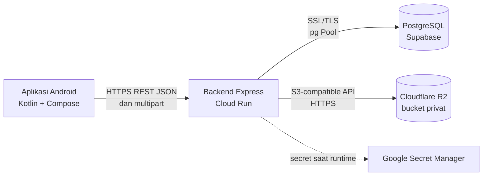

# 02 — Arsitektur IzinMu

Dokumen ini menjelaskan arsitektur yang akan dibangun pada Tahap 3–6. Keputusan yang sudah disetujui dicatat di `05-decisions.md`; kontrak API ada di `04-api-contract.md`; skema data ada di `03-database.md`.

## 1. Tujuan arsitektur

1. Memenuhi SRS v0.3 dan Pedoman Project Akhir PAM 2026.
2. Menjaga batas jelas antara aplikasi Android, backend, database, dan penyimpanan bukti.
3. Menjadikan backend satu-satunya otoritas untuk autentikasi, role, kepemilikan data, pemetaan mata kuliah, validasi tanggal, dan validasi berkas.
4. Menjaga rahasia (database, JWT, R2) hanya di sisi server.
5. Mudah diuji per lapisan dan cukup sederhana untuk dikerjakan bertahap.

## 2. Konteks sistem



Aturan batas:

- Android **tidak** terhubung langsung ke PostgreSQL, Supabase Data API, atau Cloudflare R2.
- Bukti foto tidak pernah dibagikan melalui URL publik atau presigned URL.
- Android hanya memegang access token, refresh token, dan data yang dikembalikan API.
- Backend memegang kredensial database, `JWT_SECRET`, dan kredensial R2.

## 3. Prinsip utama

| Prinsip | Penerapan |
|---|---|
| Backend sebagai otoritas | Validasi tanggal, role, pemetaan, status, dan kepemilikan dilakukan ulang di server, bukan hanya di UI |
| Stateless access token | JWT access token berumur pendek; refresh token disimpan sebagai hash dan dirotasi |
| Private by default | Bukti foto berada di bucket R2 privat; akses hanya melalui endpoint yang memeriksa hak |
| Single source of truth | Status pengajuan hanya berubah melalui endpoint keputusan; edit/hapus hanya saat `SUBMITTED` |
| No Room | Data berasal dari API; tidak ada cache relasional lokal |
| Layered Android | UI → ViewModel → Repository → API; tidak ada akses jaringan langsung dari Composable |
| Fail closed | Jika token, role, pemetaan, atau validasi tidak pasti, permintaan ditolak |
| Observability tanpa rahasia | Log memuat request id dan metadata; tidak memuat token, password, atau isi berkas |

## 4. Arsitektur Android

### 4.1 Stack

- Kotlin, Jetpack Compose, Material 3.
- MVVM dengan `ViewModel` dan `StateFlow`.
- `androidx.navigation:navigation-compose` untuk navigasi.
- OkHttp + Retrofit + Kotlin Serialization untuk JSON dan multipart.
- Coil untuk menampilkan bukti foto dari endpoint privat dengan header autentikasi.
- Penyimpanan token terenkripsi berbasis Android Keystore.
- Coroutines untuk pekerjaan asynchronous.

Versi dependensi dikunci di `gradle/libs.versions.toml` pada Tahap 4 setelah dicek kompatibel dengan Kotlin/AGP yang ada. Tidak ada Room, tidak ada database lokal.

### 4.2 Struktur paket yang direncanakan

```text
com.example.izinmu/
├── IzinMuApplication.kt
├── MainActivity.kt
├── core/
│   ├── di/AppContainer.kt
│   ├── network/ApiClient.kt
│   ├── network/AuthInterceptor.kt
│   ├── network/TokenAuthenticator.kt
│   ├── session/SessionStore.kt
│   ├── time/ServerClock.kt
│   └── ui/Theme.kt, Components.kt
├── data/
│   ├── auth/AuthRepository.kt
│   ├── course/CourseRepository.kt
│   ├── leave/LeaveRepository.kt
│   ├── admin/AdminRepository.kt
│   ├── local/EvidenceFileStore.kt
│   └── remote/dto/*.kt
├── domain/
│   └── model/*.kt
└── ui/
    ├── navigation/AppNavHost.kt
    ├── auth/LoginScreen.kt, RegisterScreen.kt, PendingScreen.kt
    ├── student/StudentHomeScreen.kt, LeaveFormScreen.kt, LeaveHistoryScreen.kt, LeaveDetailScreen.kt
    ├── instructor/InstructorHomeScreen.kt, ReviewScreen.kt, ReviewDetailScreen.kt
    └── admin/AdminHomeScreen.kt, UserListScreen.kt, UserFormScreen.kt,
        CourseListScreen.kt, CourseFormScreen.kt, MappingScreen.kt, AuditScreen.kt
```

Nama paket final dapat berubah jika ada kebutuhan teknis, tetapi batas layer dipertahankan.

### 4.3 Alur state

Setiap layar memiliki satu `ViewModel` dengan state eksplisit:

```kotlin
sealed interface UiState<out T> {
    data object Loading : UiState<Nothing>
    data class Success<T>(val data: T) : UiState<T>
    data object Empty : UiState<Nothing>
    data class Error(val message: String, val code: String?) : UiState<Nothing>
}
```

Aturan:

- Composable tidak memanggil repository atau API secara langsung.
- Event pengguna dikirim ke ViewModel; ViewModel memanggil repository.
- Repository mengembalikan hasil bertipe (`Result` atau sealed result) dan memetakan error API menjadi pesan yang aman.
- State yang tidak boleh hilang saat rotasi disimpan di ViewModel, bukan di Composable.
- Form menyimpan draft di `rememberSaveable`; file foto disimpan di cache aplikasi sampai unggah berhasil.

### 4.4 Navigasi dan pembatasan role

- Satu `NavHost` dengan route bertipe.
- Setelah login, backend mengembalikan role; aplikasi memilih graph awal:
  - `STUDENT` → beranda mahasiswa.
  - `INSTRUCTOR` → beranda instruktur.
  - `ADMIN` → beranda admin.
- Route terlindungi memeriksa sesi dan role sebelum menampilkan layar.
- Backend tetap memeriksa role; pembatasan navigasi hanya untuk UX, bukan keamanan.
- Perpindahan ke login terjadi bila refresh token tidak valid/expired atau pengguna logout.
- Tidak ada deep link pada versi ini.

### 4.5 Sesi dan autentikasi

1. Login mengirim email/password ke `/auth/login`.
2. Backend mengembalikan access token (15 menit) dan refresh token (7 hari).
3. `SessionStore` menyimpan keduanya di penyimpanan terenkripsi; token tidak ditulis ke log.
4. `AuthInterceptor` menambahkan `Authorization: Bearer <access>`.
5. Jika respons `401 TOKEN_EXPIRED`, `TokenAuthenticator` memanggil `/auth/refresh` satu kali, menyimpan pasangan baru, lalu mengulang permintaan.
6. Jika refresh gagal, sesi dihapus dan pengguna diarahkan ke login.
7. Logout memanggil `/auth/logout` dengan refresh token, lalu menghapus sesi lokal.

Refresh token lama tidak boleh dipakai ulang. Jika server mendeteksi token yang sudah dicabut, server mencabut seluruh refresh token aktif pengguna dan klien harus login ulang.

### 4.6 Pengambilan dan unggah bukti

Alur unggah:

1. Pengguna memilih foto dari kamera/galeri melalui `ActivityResultContracts`.
2. Aplikasi menyalin byte ke cache privat.
3. Aplikasi memeriksa tipe MIME dan ukuran (maksimum 5 MB) sebagai validasi awal.
4. Aplikasi menampilkan pratinjau.
5. Saat submit, aplikasi mengirim multipart ke backend.
6. Backend memeriksa ulang MIME, magic byte, ukuran, role, pemetaan, tanggal, dan duplikasi.
7. Backend mengunggah ke R2, lalu menyimpan metadata pengajuan.
8. Setelah sukses, cache lokal dihapus.

Alur baca bukti:

1. Aplikasi meminta `/leave-requests/{id}/evidence` dengan header autentikasi.
2. Backend memeriksa role, kepemilikan/pemetaan, lalu mengalirkan objek dari R2.
3. Coil memuat gambar dengan header tersebut; tidak ada URL R2 yang diekspos ke UI.

Jika unggah R2 berhasil tetapi penyimpanan database gagal, backend menghapus objek R2 sebagai kompensasi. Jika penghapusan kompensasi gagal, objek dicatat sebagai yatim untuk pembersihan terkontrol (TBD-10).

### 4.7 Waktu

- Aplikasi memanggil `/meta/time` untuk mendapatkan `serverDate` dan `serverTime` berzona Asia/Jakarta.
- Tanggal yang dapat dipilih adalah `serverDate` (H) atau `serverDate + 1` (H-1), dengan hari yang sama dengan `class_day` mata kuliah.
- Aplikasi hanya menampilkan tanggal yang valid; backend tetap memvalidasi ulang.
- Perangkat yang jamnya salah tidak dapat mengakali validasi karena backend memakai waktunya sendiri.
- Waktu audit ditampilkan dalam zona perangkat, tetapi disimpan dan dikirim dalam UTC.

## 5. Arsitektur backend

### 5.1 Stack

- Node.js 24 LTS, JavaScript ESM.
- Express 5.
- `pg` dengan connection pool.
- `jsonwebtoken` untuk JWT.
- `bcrypt` untuk hash password.
- `@aws-sdk/client-s3` untuk Cloudflare R2 (S3-compatible).
- Validasi input dengan library yang dipilih pada Tahap 3; tidak ada validasi ad-hoc yang tersebar.
- `helmet`, `express-rate-limit`, dan logging terstruktur.
- Tanpa ORM; SQL eksplisit dan parameterized.

### 5.2 Struktur paket yang direncanakan

```text
backend/
├── package.json
├── .env.example
├── Dockerfile
├── migrations/
│   ├── 001_init.up.sql
│   ├── 001_init.down.sql
│   └── ...
├── scripts/
│   ├── migrate.js
│   └── create-admin.js
└── src/
    ├── app.js
    ├── server.js
    ├── config/env.js
    ├── db/pool.js
    ├── middleware/auth.js
    ├── middleware/roles.js
    ├── middleware/error.js
    ├── middleware/requestId.js
    ├── modules/
    │   ├── auth/
    │   ├── users/
    │   ├── courses/
    │   ├── mappings/
    │   ├── leaveRequests/
    │   └── meta/
    ├── services/r2.js
    ├── services/token.js
    └── utils/time.js
```

`app.js` mengekspor aplikasi Express untuk pengujian; `server.js` hanya membuka port. Ini memungkinkan integration test tanpa server eksternal.

### 5.3 Siklus permintaan

```text
request
  → requestId + logging
  → helmet + body limit
  → route
  → auth (JWT) bila perlu
  → role guard
  → validasi input
  → service/query (parameterized)
  → response envelope
  → error handler terpusat
```

Aturan:

- Route tidak menulis SQL sendiri; query berada di repository/module.
- Pemeriksaan role dan kepemilikan dilakukan di service sebelum query data sensitif.
- Error yang tidak terduga tidak mengembalikan stack trace atau detail database.
- Semua respons error memakai kode yang stabil agar Android dapat memetakan pesan.

### 5.4 Autentikasi dan sesi

- Password di-hash dengan bcrypt (cost 12).
- Access token JWT HS256 berisi `sub`, `role`, `jti`, `iat`, `exp`; umur 15 menit.
- Refresh token adalah string acak 256-bit; yang disimpan hanya SHA-256 hash.
- Setiap refresh merotasi token: token lama `revoked_at` diisi, `replaced_by_token_id` menunjuk token baru.
- Logout mencabut refresh token berdasarkan hash dan bersifat idempotent.
- Setiap permintaan terautentikasi memuat ulang pengguna dari database dan menolak akun `is_active = false`.
- Perubahan role atau status akun langsung berlaku pada permintaan berikutnya.

### 5.5 Otorisasi

| Role | Cakupan |
|---|---|
| `STUDENT` | Data diri, mata kuliah yang diikuti, pengajuan miliknya |
| `INSTRUCTOR` | Mata kuliah yang diampu, pengajuan pada mata kuliah tersebut |
| `ADMIN` | Seluruh akun, mata kuliah, pemetaan, pengajuan, dan bukti (baca) |

Pemeriksaan wajib:

- Mahasiswa hanya dapat membuat pengajuan untuk mata kuliah yang terdaftar (`course_enrollments`).
- Instruktur hanya dapat melihat/memutuskan pengajuan pada mata kuliah yang terdaftar (`course_instructors`).
- Mahasiswa hanya dapat mengubah/menghapus pengajuannya sendiri dan hanya saat `SUBMITTED`.
- Instruktur tidak dapat mengubah data mahasiswa atau pengajuan yang sudah final.
- Admin tidak dapat mengubah keputusan atau menghapus pengajuan; audit bersifat baca.
- Admin tidak dapat menonaktifkan akunnya sendiri.

### 5.6 Validasi tanggal

- `APP_TIMEZONE=Asia/Jakarta`.
- `serverDate` dihitung dari waktu server.
- Rentang yang diterima: `classDate` = `serverDate` atau `serverDate + 1`.
- `classDate` juga harus jatuh pada `courses.class_day`.
- Untuk update: jika `classDate` tidak berubah, validasi jendela tidak diulang; jika berubah, seluruh aturan berlaku.
- Perbandingan tanggal dilakukan pada level tanggal kalender, bukan selisih 24 jam.

### 5.7 Validasi bukti foto

- Tepat satu berkas pada create; opsional pada update.
- MIME yang diterima: `image/jpeg`, `image/png`.
- Ekstensi yang diterima: `.jpg`, `.jpeg`, `.png`.
- Ukuran maksimum 5 MB (5.242.880 byte).
- Magic byte diperiksa; MIME dari klien tidak dipercaya.
- Nama file asli tidak dipakai sebagai object key.
- Object key: `leave-requests/{studentUserId}/{uuid}.{ext}`.
- Bucket R2 privat; tidak ada public access.
- Bukti lama dihapus setelah penggantian berhasil; kegagalan hapus dicatat.

### 5.8 Konfigurasi environment

Nama variabel (nilai tidak boleh masuk Git):

```text
NODE_ENV
PORT
DATABASE_URL
JWT_SECRET
JWT_ACCESS_TTL_SECONDS
JWT_REFRESH_TTL_SECONDS
APP_TIMEZONE
R2_ENDPOINT
R2_ACCESS_KEY_ID
R2_SECRET_ACCESS_KEY
R2_BUCKET
R2_REGION
MAX_EVIDENCE_BYTES
```

`config/env.js` gagal saat startup jika variabel wajib tidak ada. Tidak ada nilai default untuk rahasia.

### 5.9 Deployment

- Backend sebagai container Docker, listen pada `PORT` (default Cloud Run 8080).
- Cloud Run terhubung ke Supabase melalui pooler dengan SSL.
- Secret disuntikkan dari Secret Manager.
- Health check `GET /health` memeriksa koneksi database.
- Tidak ada kredensial di image, repository, atau APK.

## 6. Batas data dan penyimpanan

| Data | Lokasi | Akses |
|---|---|---|
| Akun, mata kuliah, pemetaan, pengajuan, refresh token | PostgreSQL Supabase | Backend saja |
| Bukti foto | Cloudflare R2 privat | Backend saja; Android melalui endpoint streaming |
| Token sesi Android | Penyimpanan terenkripsi perangkat | Aplikasi |
| Draft foto sementara | Cache privat aplikasi | Aplikasi |

Tidak ada data sensitif di log. ID pengguna dan ID pengajuan boleh dicatat untuk audit.

## 7. Penanganan error dan pengalaman pengguna

- Semua error API memiliki `code` dan `message` yang dapat ditampilkan.
- Android memetakan kode menjadi pesan Indonesia yang spesifik; detail teknis tidak ditampilkan.
- Kesalahan validasi ditampilkan per field bila tersedia.
- `401` memicu refresh satu kali; bila gagal, kembali ke login.
- `403` menampilkan pesan akses ditolak tanpa membocorkan data.
- `409` pada pengajuan berarti data sudah berubah; aplikasi memuat ulang detail.
- `413`/`415` pada foto menampilkan batas 5 MB dan tipe yang didukung.
- `5xx` menampilkan pesan umum dan tombol coba lagi.

## 8. Pengujian yang direncanakan

### Backend

- Unit: validasi tanggal, role, transisi status, hash/rotate token, validasi MIME.
- Integration: endpoint dengan database sementara; skenario student/instructor/admin; unggah dan baca bukti.
- Security: akses lintas data, IDOR, token kedaluwarsa, refresh reuse, file spoofing.

### Android

- Unit: ViewModel dan mapper error.
- UI/instrumentation: alur login, submit, edit/hapus, keputusan, admin CRUD.
- Manual: tiga role, perangkat tanpa kamera, jaringan lambat, rotasi.

## 9. Non-goals versi ini

- Login dengan akun kampus/SSO.
- Reset password mandiri.
- Notifikasi push.
- Impor CSV massal.
- Web admin.
- Edit/hapus pengajuan oleh Admin.
- Penyimpanan offline/Room.
- Kompresi atau retensi otomatis foto.
- Multi-kampus atau multi-prodi.

## 10. Pemetaan ke tahap

| Tahap | Fokus |
|---|---|
| 1 | Audit dan keputusan |
| 2 | SRS v0.3, diagram, arsitektur, kontrak API, skema awal |
| 3 | Backend auth, database, migration runner, RBAC, health |
| 4 | Android fondasi, sesi, navigasi, UI role |
| 5 | Fitur CRUDS, unggah/baca bukti, keputusan |
| 6 | Integrasi R2, deployment, pengujian, dokumentasi akhir |
