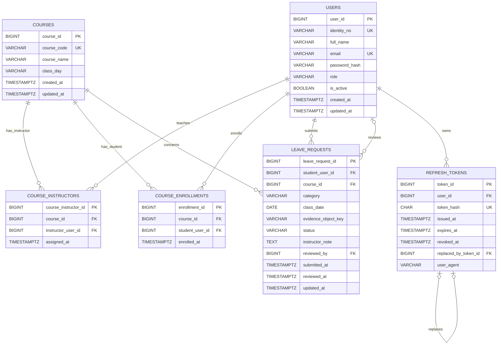

# 03 — Skema Database IzinMu

Database: PostgreSQL 15+ yang dikelola Supabase.  
Migrasi awal: `backend/migrations/001_init.up.sql` dan `001_init.down.sql`.  
Sumber kebenaran: SRS v0.3 dan file migrasi. Dokumen ini menjelaskan maksud dan invariannya.

## 1. Ringkasan

Enam tabel inti:

1. `users` — akun Admin, Instruktur, dan Mahasiswa.
2. `courses` — mata kuliah dan hari kuliah.
3. `course_instructors` — pemetaan Instruktur ke mata kuliah.
4. `course_enrollments` — pemetaan Mahasiswa ke mata kuliah.
5. `leave_requests` — pengajuan izin, status, keputusan, dan referensi bukti.
6. `refresh_tokens` — sesi refresh token yang di-hash dan dirotasi.

Tidak ada tabel sesi kuliah, jadwal jam, notifikasi, atau audit log terpisah. Audit Admin memakai data pada `leave_requests`.

## 2. ERD



## 3. Nilai terkendali

| Kolom | Nilai | Catatan |
|---|---|---|
| `users.role` | `ADMIN`, `STUDENT`, `INSTRUCTOR` | Bukan native ENUM; memakai CHECK |
| `courses.class_day` | `MONDAY` … `SUNDAY` | Nama hari Inggris; UI menampilkan label Indonesia |
| `leave_requests.category` | `SICK`, `ACADEMIC`, `EMERGENCY`, `FAMILY` | UI: Sakit, Akademik, Mendadak, Keperluan Keluarga |
| `leave_requests.status` | `SUBMITTED`, `APPROVED`, `REJECTED` | UI: Diajukan, Disetujui, Ditolak |

Tidak ada status tambahan seperti `DRAFT`, `CANCELLED`, `EXPIRED`, atau `REVOKED`. Pembatalan oleh mahasiswa dilakukan dengan menghapus pengajuan selama masih `SUBMITTED`.

## 4. Definisi tabel

### 4.1 `users`

| Kolom | Tipe | Constraint | Keterangan |
|---|---|---|---|
| `user_id` | `BIGINT` | PK, identity | ID internal |
| `identity_no` | `VARCHAR(30)` | NOT NULL, UNIQUE | NIM untuk mahasiswa; NIDN/kode untuk dosen/admin |
| `full_name` | `VARCHAR(150)` | NOT NULL, non-blank | Nama tampilan |
| `email` | `VARCHAR(254)` | NOT NULL, unik case-insensitive, lowercase, tanpa spasi | Dipakai login |
| `password_hash` | `VARCHAR(255)` | NOT NULL | bcrypt cost 12 |
| `role` | `VARCHAR(20)` | NOT NULL, CHECK | Satu role per akun |
| `is_active` | `BOOLEAN` | NOT NULL, default TRUE | Registrasi mandiri menyimpan FALSE |
| `created_at` | `TIMESTAMPTZ` | NOT NULL, default now() | UTC |
| `updated_at` | `TIMESTAMPTZ` | NOT NULL, default now() | Diperbarui backend |

Aturan:

- Email disimpan lowercase; API menormalkan input.
- `identity_no` unik; tidak boleh hanya spasi.
- Tidak ada kolom `deleted_at`; penonaktifan memakai `is_active = FALSE`.
- Role tidak dapat diubah melalui API setelah akun dibuat.
- Password tidak pernah dikembalikan API.

### 4.2 `courses`

| Kolom | Tipe | Constraint | Keterangan |
|---|---|---|---|
| `course_id` | `BIGINT` | PK, identity | ID internal |
| `course_code` | `VARCHAR(20)` | NOT NULL, UNIQUE, uppercase | Kode mata kuliah |
| `course_name` | `VARCHAR(150)` | NOT NULL, non-blank | Nama mata kuliah |
| `class_day` | `VARCHAR(10)` | NOT NULL, CHECK | Satu hari kuliah per mata kuliah |
| `created_at` | `TIMESTAMPTZ` | NOT NULL, default now() | UTC |
| `updated_at` | `TIMESTAMPTZ` | NOT NULL, default now() | Diperbarui backend |

Aturan:

- Satu mata kuliah hanya memiliki satu `class_day`; tidak ada tabel sesi/jam.
- `course_code` disimpan uppercase; backend menormalkan input dan CHECK database menolak huruf kecil.
- Perubahan `class_day` tidak mengubah pengajuan lama; validasi baru memakai nilai terbaru untuk pengajuan berikutnya.
- Tidak ada kolom aktif/arsip. Penghapusan hanya boleh jika belum direferensikan.

### 4.3 `course_instructors`

| Kolom | Tipe | Constraint | Keterangan |
|---|---|---|---|
| `course_instructor_id` | `BIGINT` | PK, identity | ID pemetaan |
| `course_id` | `BIGINT` | FK `courses`, NOT NULL, RESTRICT | Mata kuliah |
| `instructor_user_id` | `BIGINT` | FK `users`, NOT NULL, RESTRICT | Harus user role `INSTRUCTOR` |
| `assigned_at` | `TIMESTAMPTZ` | NOT NULL, default now() | UTC |

Unique: `(course_id, instructor_user_id)`.

Catatan: foreign key database tidak dapat memaksa `users.role = 'INSTRUCTOR'`; backend wajib memeriksa role dan `is_active` sebelum insert.

### 4.4 `course_enrollments`

| Kolom | Tipe | Constraint | Keterangan |
|---|---|---|---|
| `enrollment_id` | `BIGINT` | PK, identity | ID pemetaan |
| `course_id` | `BIGINT` | FK `courses`, NOT NULL, RESTRICT | Mata kuliah |
| `student_user_id` | `BIGINT` | FK `users`, NOT NULL, RESTRICT | Harus user role `STUDENT` |
| `enrolled_at` | `TIMESTAMPTZ` | NOT NULL, default now() | UTC |

Unique: `(course_id, student_user_id)`.

Catatan: backend wajib memeriksa role `STUDENT` dan `is_active`.

### 4.5 `leave_requests`

| Kolom | Tipe | Constraint | Keterangan |
|---|---|---|---|
| `leave_request_id` | `BIGINT` | PK, identity | ID pengajuan |
| `student_user_id` | `BIGINT` | FK `users`, NOT NULL, RESTRICT | Pemilik pengajuan |
| `course_id` | `BIGINT` | FK `courses`, NOT NULL, RESTRICT | Mata kuliah |
| `category` | `VARCHAR(20)` | NOT NULL, CHECK | Empat kategori |
| `class_date` | `DATE` | NOT NULL | Tanggal kuliah yang ditinggalkan |
| `evidence_object_key` | `VARCHAR(1024)` | NOT NULL, bukan URL | Object key R2 privat |
| `status` | `VARCHAR(20)` | NOT NULL, default `SUBMITTED` | Status keputusan |
| `instructor_note` | `TEXT` | NULL | Catatan opsional |
| `reviewed_by` | `BIGINT` | FK `users`, NULL, RESTRICT | Instruktur peninjau |
| `submitted_at` | `TIMESTAMPTZ` | NOT NULL, default now() | UTC |
| `reviewed_at` | `TIMESTAMPTZ` | NULL | UTC |
| `updated_at` | `TIMESTAMPTZ` | NOT NULL, default now() | UTC |

Constraint penting:

```sql
UNIQUE (student_user_id, course_id, class_date)
```

Mencegah lebih dari satu pengajuan untuk mahasiswa, mata kuliah, dan tanggal kuliah yang sama.

```sql
CHECK (
  (status = 'SUBMITTED' AND reviewed_by IS NULL AND reviewed_at IS NULL)
  OR
  (status IN ('APPROVED', 'REJECTED') AND reviewed_by IS NOT NULL AND reviewed_at IS NOT NULL)
)
```

Menjaga konsistensi status dan metadata keputusan.

```sql
CHECK (length(btrim(evidence_object_key)) > 0 AND lower(evidence_object_key) NOT LIKE 'http%')
```

Memastikan yang disimpan adalah object key, bukan URL publik.

### 4.6 `refresh_tokens`

| Kolom | Tipe | Constraint | Keterangan |
|---|---|---|---|
| `token_id` | `BIGINT` | PK, identity | ID token |
| `user_id` | `BIGINT` | FK `users`, NOT NULL, CASCADE | Pemilik sesi |
| `token_hash` | `CHAR(64)` | NOT NULL, UNIQUE, regex hex | SHA-256 dari token mentah |
| `issued_at` | `TIMESTAMPTZ` | NOT NULL, default now() | UTC |
| `expires_at` | `TIMESTAMPTZ` | NOT NULL, > `issued_at` | 7 hari |
| `revoked_at` | `TIMESTAMPTZ` | NULL | Diisi saat rotasi/logout |
| `replaced_by_token_id` | `BIGINT` | FK self, NULL, SET NULL | Rantai rotasi |
| `user_agent` | `VARCHAR(255)` | NULL | Audit sesi |

Aturan:

- Token mentah hanya dikirim ke klien; database tidak pernah menyimpannya.
- Hash memakai SHA-256 hex 64 karakter.
- Rotasi: token lama `revoked_at = now()`, `replaced_by_token_id = token baru`.
- Reuse token yang sudah dicabut dicurigai sebagai pencurian; backend mencabut seluruh sesi aktif pengguna.
- Logout menandai `revoked_at`; tidak harus menghapus baris.
- Baris kedaluwarsa dibersihkan oleh job terpisah (TBD).

## 5. Indeks

| Indeks | Tujuan |
|---|---|
| `users_email_lower_uk` | Login dan cegah duplikasi email case-insensitive |
| `users_identity_no_uk` | Cegah duplikasi NIM/NIDN |
| `users_role_active_idx` | Filter akun per role/status |
| `users_full_name_trgm_idx`, `users_identity_no_trgm_idx` | Pencarian nama/NIM |
| `courses_code_uk` | Cegah duplikasi kode |
| `courses_class_day_idx` | Filter hari |
| `courses_name_trgm_idx`, `courses_code_trgm_idx` | Pencarian mata kuliah |
| `course_instructors_pair_uk` | Cegah pemetaan ganda |
| `course_instructors_instructor_idx` | Daftar kelas per instruktur |
| `course_enrollments_pair_uk` | Cegah pemetaan ganda |
| `course_enrollments_student_idx` | Daftar mata kuliah per mahasiswa |
| `leave_requests_one_per_date_uk` | Cegah pengajuan ganda |
| `leave_requests_student_submitted_idx` | Riwayat mahasiswa |
| `leave_requests_course_status_idx` | Daftar review instruktur |
| `leave_requests_status_submitted_idx` | Audit/filter status |
| `leave_requests_class_date_idx` | Filter tanggal |
| `leave_requests_category_date_idx` | Filter kategori/tanggal |
| `leave_requests_reviewer_idx` | Audit per peninjau |
| `refresh_tokens_user_expiry_idx` | Sesi per pengguna |
| `refresh_tokens_active_idx` | Pembersihan token aktif/kedaluwarsa |

Pencarian teks memakai ekstensi `pg_trgm` dan indeks GIN. Migrasi membuat ekstensi tersebut; rollback tidak menghapusnya.

## 6. Waktu dan tanggal

- Semua timestamp disimpan `TIMESTAMPTZ` dalam UTC.
- `class_date` adalah `DATE` kalender, tanpa zona.
- “Hari ini” dan “H-1” dihitung backend memakai `APP_TIMEZONE=Asia/Jakarta`.
- `submitted_at` dan `updated_at` diisi server, bukan klien.
- `reviewed_at` diisi saat keputusan berhasil.
- Perbandingan jendela pengajuan memakai tanggal kalender Jakarta, bukan selisih 24 jam dari waktu klien.

## 7. Penghapusan dan arsip

| Objek | Perilaku |
|---|---|
| `users` | `DELETE /admin/users/{id}` menonaktifkan (`is_active = FALSE`), bukan hard delete |
| `courses` | Hard delete hanya jika tidak ada pemetaan/pengajuan; jika ada, `409` |
| `course_instructors` | Hard delete; tidak memengaruhi pengajuan lama |
| `course_enrollments` | Hard delete; tidak memengaruhi pengajuan lama |
| `leave_requests` | Hard delete oleh pemilik saat `SUBMITTED`; objek R2 ikut dihapus (best effort) |
| `refresh_tokens` | Dicabut, lalu dibersihkan setelah kedaluwarsa |

Foreign key `ON DELETE RESTRICT` pada `leave_requests` mencegah penghapusan user/course yang masih direferensikan. Ini alasan utama penonaktifan user, bukan hard delete.

## 8. Migrasi

- File `001_init.up.sql` membuat ekstensi, tabel, constraint, dan indeks.
- `001_init.down.sql` menghapus tabel dalam urutan dependensi; ekstensi tidak dihapus.
- Setiap migrasi dijalankan dalam transaksi.
- Migration runner (Tahap 3) akan:
  1. Membuat tabel `schema_migrations` bila belum ada.
  2. Membaca file `*.up.sql` yang belum tercatat.
  3. Menjalankan berurutan dan mencatat nama file + waktu.
  4. Menolak migrasi yang gagal tanpa mencatatnya.
- Tidak ada seed data di migrasi.
- Admin pertama dibuat melalui CLI one-off, bukan migrasi.

Perintah verifikasi lokal (setelah backend Tahap 3):

```bash
cd backend
npm run migrate
```

Rollback hanya untuk lingkungan pengembangan:

```bash
psql "$DATABASE_URL" -f migrations/001_init.down.sql
```

## 9. Admin pertama

CLI `npm run create-admin` (Tahap 3) membaca:

```text
BOOTSTRAP_ADMIN_IDENTITY_NO
BOOTSTRAP_ADMIN_FULL_NAME
BOOTSTRAP_ADMIN_EMAIL
BOOTSTRAP_ADMIN_PASSWORD
```

Aturan:

- Tidak ada password default di kode.
- Password minimal 8 karakter, disarankan 12+.
- Email dinormalkan lowercase.
- Jika email/identity sudah ada, gagal dengan pesan jelas.
- Jika sudah ada akun `ADMIN`, CLI menolak kecuali dijalankan dengan flag eksplisit untuk lingkungan pengembangan.
- Kredensial hanya dimasukkan melalui environment/Secret Manager, tidak ditulis ke file yang di-commit.

## 10. Pola query penting

- Daftar mata kuliah mahasiswa: join `course_enrollments` → `courses` dengan `student_user_id`.
- Daftar mata kuliah instruktur: join `course_instructors` → `courses` dengan `instructor_user_id`.
- Daftar pengajuan instruktur: join `leave_requests` → `course_instructors` pada `course_id` dan `instructor_user_id`.
- Detail pengajuan: ambil pengajuan + user + course, lalu periksa scope di service.
- Keputusan atomik:

```sql
UPDATE leave_requests
SET status = $1,
    instructor_note = $2,
    reviewed_by = $3,
    reviewed_at = now(),
    updated_at = now()
WHERE leave_request_id = $4
  AND status = 'SUBMITTED'
RETURNING *;
```

Jika `rowCount = 0`, pengajuan sudah final atau tidak ada; service mengembalikan `409`/`404`.

- Pencarian Admin: filter role/status, lalu `ILIKE` pada nama/NIM/kode/nama mata kuliah; `pg_trgm` mempercepat pola `%q%`.

## 11. TBD yang masih terbuka

| ID | Isu | Dampak |
|---|---|---|
| TBD-4 | Retensi foto | Kapan bukti dihapus setelah pengajuan final |
| TBD-6 | Backup, pemulihan, region, biaya | RPO/RTO dan ketersediaan |
| TBD-8 | Cakupan/rotasi token R2 | Kredensial penyimpanan |
| TBD-9 | Paket Supabase | Ketersediaan saat penilaian |
| TBD-10 | Pembersihan objek R2 yatim | Prosedur dan jadwal pembersihan |
| — | Kebijakan retensi data | Berapa lama data disimpan |

Semua TBD ini tidak menghambat Tahap 3; keputusan dapat diambil sebelum produksi.
